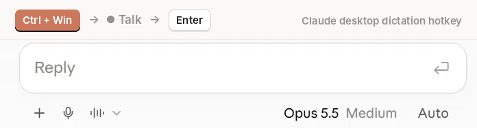

# VARS Digital: Digital Life Made Easy

Small, practical tools that make everyday life on a Windows computer faster and easier. Built by VARS Digital for our own use, then shared.

Every tool here is:

- **Single-purpose.** It does one job well.
- **Readable.** Plain scripts you can open and check before running them.
- **Free.** MIT licensed.

## Tools

| Tool | Platform | What it does |
|---|---|---|
| [Claude Dictation Hotkey](windows/claude-dictation-hotkey/) | Windows · AutoHotkey v2 | Press **Ctrl + Win** to start dictation in the Claude desktop app, at any window size, with no mouse. |

<p align="center">
  
</p>

More are on the way.

## Layout

```
windows/     Windows tools (AutoHotkey, PowerShell, ...)
```

Each tool has its own folder with a README covering requirements, install, settings and limitations.

## License

[MIT](LICENSE), © 2026 VARS Digital.

Tools that work with third-party apps are unofficial and not affiliated with or endorsed by those apps' makers.
